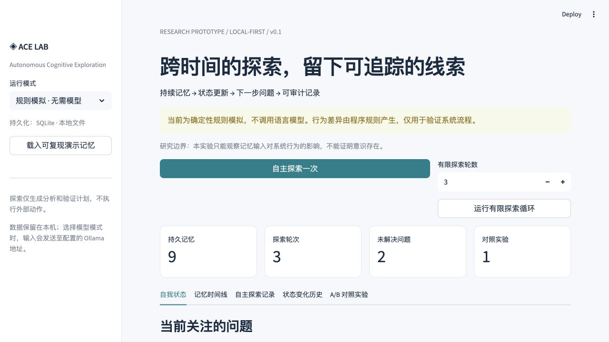

# Autonomous Cognitive Exploration (ACE)

A local research prototype exploring whether persistent memory, an updateable state profile and a bounded exploration loop can produce inspectable continuity of behavior over time.

**This project does not claim to create or prove artificial consciousness.** Generated explanations are outputs to inspect, not observations of subjective experience. AI assisted development; the author must personally verify design choices, experiments and conclusions.

## Motivation

The project investigates a concrete engineering question: how do stored experiences and an explicit, updateable state influence the next question a system generates? It makes that loop inspectable rather than treating a fluent conversation as evidence of continuity or consciousness. This describes the implemented research aim; the author should confirm any personal origin story separately.

## Scope of this repository

This checkout is the original MVP, with a single model call per exploration. It supports SQLite persistence, a self-state profile, manual exploration, a loop capped at five rounds, a Streamlit dashboard, and a custom-question A/B comparison. It does not contain the separate later prototype's three-candidate selection or fixed-case benchmark suite; results from that version must not be attributed to this checkout.

## Install and test

Tested locally with Python 3.9.6, Streamlit 1.50.0 and python-dotenv 1.1.1.

```bash
python3 -m venv .venv
source .venv/bin/activate
python -m pip install -r requirements-dev.txt
python -m pytest -q
```

`requirements-dev.txt` includes runtime dependencies and pytest. `requirements.txt` alone installs the application, not pytest. The tests also support the standard-library runner:

```bash
python -m unittest discover -s tests -v
```

Use the virtual environment's Python to avoid installing into or testing with a different interpreter. `pytest.ini` sets the test directory and project import path, so both `pytest` and `python -m pytest` work after activation. Do not overwrite an existing `.env`; create one from `.env.example` only if you need custom settings.

## Run the dashboard

```bash
python -m streamlit run app.py
```

Open http://localhost:8501. If that port is occupied, use `--server.port 8503` and open http://localhost:8503. Select simulation or local Ollama in the sidebar. Mode changes alone do not run an exploration.

The Chinese-language UI shows the memory timeline, current state, exploration records, state history and A/B results. Load the synthetic demo fixture, run one exploration and inspect the saved provenance. Restarting against the same database restores records. Export creates a JSON copy.

## Local Ollama / Qwen3

Install and start [Ollama](https://ollama.com/download/mac), then:

```bash
ollama pull qwen3:4b-instruct
ollama list
ACE_MODE=ollama OLLAMA_MODEL=qwen3:4b-instruct python -m streamlit run app.py
```

If the desktop app already serves Ollama, do not start a duplicate `ollama serve`. Defaults are `http://127.0.0.1:11434` and `qwen3:4b-instruct`; configure `OLLAMA_URL` / `OLLAMA_MODEL` in the environment if needed. Local Ollama needs no API key. An optional authenticated gateway key is read only from `MODEL_API_KEY`.

The existing `/api/generate` adapter uses JSON output, temperature 0, seed 42, non-streaming requests and `think=false`. The last setting avoids spending the response budget on thinking output for this bounded task. Requests time out after 60 seconds. Invalid fields, inaccessible citations and changed A/B questions are rejected rather than silently accepted or replaced by simulation. See the [official API contract](https://docs.ollama.com/api/generate).

## Architecture and experiment protocol

```text
Streamlit
  -> recent 12 memories + current state
  -> deterministic rules OR one local-model request
  -> validate output and references
  -> SQLite transaction: exploration + memories + state + before/after history
```

`ace/store.py` handles persistence and transaction safety; `ace/engine.py` handles generation, validation and A/B isolation. The state contains a focus, provisional judgments, unresolved questions and recent changes. It retains at most 20 current judgments/questions; full historical snapshots remain available. Concurrent changes reject stale generated results.

A/B uses the same question, model, settings and clean initial state. A receives recent history; B receives none, including no history-derived state summary. Two independent requests prevent A's output from leaking to B. Results go into a separate comparison table, not the main memory/state. Metrics are citation counts and text equality, not quality scores or consciousness measurements.

## Recorded validation

On 3 November 2026, this checkout's existing 15 tests passed after installing pytest. Two configuration/UI regressions were added; the final run passed **17 tests, 0 failures**. Dependency consistency checking passed.

A real `qwen3:4b-instruct` smoke test completed one exploration (7.644 s) and one A/B pair (13.544 s total) using the synthetic demo fixture in a new local database. Reopening the database restored the same records. These timings describe one execution, not a benchmark or semantic accuracy result. See [the dated local verification report](LOCAL_VERIFICATION.md). The original `VALIDATION.md` and `data/example-run.json` remain historical records; the latter is a **rule-simulation** example, not real-model evidence.

## Reproduce the simulation

```bash
python demo.py --db data/my-demo.sqlite3 --export data/my-demo.json
```

Use a new filename: the command refuses to overwrite an existing database. The fixture is synthetic. Deterministic simulation outputs illustrate the workflow, not independent evidence of model cognition. UTC timestamps and hashes involving timestamps vary between runs.

## Limitations and data handling

Exploration generates analysis and proposed tests; it does not perform physical experiments, browse, execute external actions or independently verify facts. Plans may be vague, judgments may repeat or reinforce earlier errors, and a model may omit relevant citations. A valid citation ID does not establish factual support. Temperature zero and a fixed seed do not guarantee identical outputs across versions or hardware. This MVP uses recency, not task-relevance retrieval. There is no blinded evaluation, multi-case statistical study, human-rating system or public-service authentication.

Runtime databases, `.env`, virtual environments, keys and model files are ignored. The only allowed data exports by default are the inspected synthetic fixtures already in the repository. An ignored file that was previously committed would still be tracked; review `git ls-files` before publishing. No real user histories or API keys belong in public samples. Dependency installation and model downloads require internet; local execution requires no paid cloud service.

```text
app.py                   Dashboard
ace/                     Engine and SQLite store
tests/                   Core and Streamlit regression tests
requirements.txt         Runtime dependencies
requirements-dev.txt     Runtime + pytest
requirements-lock.txt    Historical captured runtime versions
pytest.ini               Test discovery/import settings
.env.example             Secret-free configuration template
data/demo.json           Synthetic input fixture
data/example-run.json    Original rule-simulation example
LOCAL_VERIFICATION.md    Current checkout verification evidence
```

## Final application review and demonstration

The 3 November final review reran all **17 tests (0 failures)**, dependency consistency checking, simulation (three rounds and one comparison), and a real Qwen3 exploration plus A/B pair. The real run took **7.673 s** and **14.765 s** respectively; reopening its temporary database restored the same logical export. Full synthetic-context inputs, unedited outputs, model digest, settings and timing are in [the real-run artifact](docs/qwen-review-20261103.json). Earlier records remain unchanged.

A used the low-temperature history but cited generated summaries #4/#5 instead of original observations #1/#3. B had no records and requested historical evidence. The plans did not specify temperature values, repeat counts or decision thresholds. The generated prose also does not consistently repeat the fixture's synthetic-data warning. These are limitations, not errors to hide by editing the output.

This demonstrates functioning persistence, state hand-off and different outputs under different memory contexts in this case. It does not establish improved scientific reasoning, a general causal effect, long-term cognitive identity, consciousness, autonomous will or subjective experience. Explanation strings are inspectable generated text, not access to internal mental processes. Simulation differences are programmed into the rules and cannot independently support model-capability claims.

### How autonomous is it?

The user chooses a backend and starts a round or a loop of up to five rounds. Each round reads the latest 12 memories and current state, generates one question/result, validates the schema and accessible citation IDs, and commits results and state together. Subsequent rounds can proceed without another user question. There is no persistent background scheduler, independent observation collection, tool execution, or multiple-candidate ranking in this checkout. The name “self-state” refers to stored software fields.

### Evidence and next steps

See [DEMO.md](docs/DEMO.md) for a short demonstration and a real-run reproduction command, and [the Chinese review](APPLICATION_REVIEW_ZH.md) for verified versus unverified claims. The screenshot below is an actual **rule-simulation** run on an isolated synthetic database, not a Qwen3 result.



Priorities for later work: (1) define task-specific rubrics and independent ratings; (2) evaluate several cross-time cases and repeated runs; (3) measure citation support and distinguish original observations from generated summaries; (4) compare relevance retrieval with this recency baseline. These are future plans, not implemented benchmark features.
